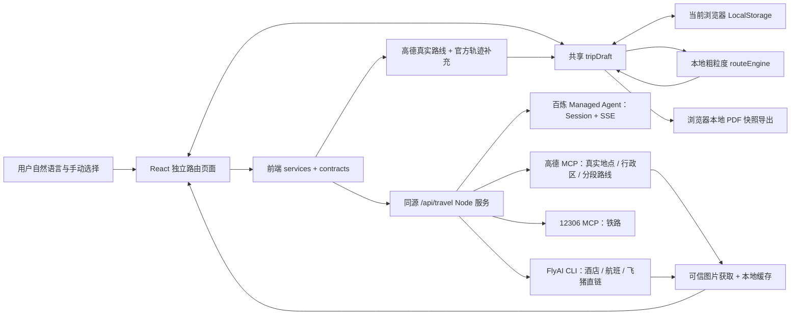

# 项目架构

基准：CP-V2-2026-10-17。目标来自[产品目标](PRODUCT_GOALS.md)与[功能需求](FUNCTIONAL_REQUIREMENTS.md)；下文标“当前”的技术结构来自本地源码和既有接入记录，不等于所有服务此刻可用。

## 目标架构与数据流

目标是保留 UI 与业务服务分离、用户确认与推荐分离、真实数据与模拟分离。未确认的外部信息不能直接写成用户选择。

## 当前模块职责

| 模块 | 职责 |
| --- | --- |
| [App.tsx](../src/App.tsx) / [router.tsx](../src/planning/router.tsx) | 路由、前置条件、标题、转场、浏览器前进后退 |
| [TripDraftProvider](../src/planning/TripDraftProvider.tsx) / [draftContext](../src/planning/draftContext.ts) | 全页状态、LocalStorage、取消 / 超时 / 并发保护 |
| [model](../src/planning/model.ts) / [types](../src/planning/types.ts) / [payload](../src/planning/payload.ts) | 默认值、失效、恢复、数据模型与检索上下文 |
| [services](../src/planning/services.ts) / [contracts](../src/planning/contracts.ts) | live / mock 路径、服务请求、返回结构与媒体 URL 校验 |
| [SetupPages](../src/planning/components/SetupPages.tsx) | Hero 命令、旅行信息、模式、城际交通 |
| [LocationPages](../src/planning/components/LocationPages.tsx) | 区域、核心地点、品牌偏好与搜索 |
| [HotelPages](../src/planning/components/HotelPages.tsx) | 筛选、结果、对比、外链、明确酒店确认 |
| [ItineraryPages](../src/planning/components/ItineraryPages.tsx) / [routeEngine](../src/planning/routeEngine.ts) | 景点、市内偏好、粗粒度分天、移动/删除/替换/添加与自动重算 |
| [tripPdf](../src/planning/tripPdf.ts) / [TripPdfExport](../src/planning/components/TripPdfExport.tsx) | 当前草稿快照、中文分页与本地下载 |
| [server/app.js](../server/app.js) / [travel-api.js](../server/travel-api.js) | HTTP 入口、输入 / 来源 / 限额保护、能力映射 |
| [managed-agent](../server/managed-agent.js) / [sse](../server/sse.js) / [agent-tasks](../server/agent-tasks.js) | 百炼临时任务、SSE、结构化输出 |
| [mcp](../server/mcp.js) / [flyai](../server/flyai.js) / [flyai-runtime](../server/flyai-runtime.js) | 高德 / 铁路调用、FlyAI 查询、专用运行环境 |
| [image-cache](../server/image-cache.js) / [image-sources](../server/image-sources.js) | 图片来源限制、去重、转换、永久复用与失败处理 |

旧 src/components 中仍存在的 V1 组件不代表已接入 App，也不构成恢复功能授权。

## 当前服务映射

全部 POST 相对 /api/travel：

| endpoint | 前端服务 / 用途 |
| --- | --- |
| /parse-trip | parseTripPrompt：旅行信息解析 |
| /amap/search-place | searchPlaceWithAmapMCP：地点定位 |
| /amap/resolve-district | resolveDistrictWithAmapMCP：行政区 |
| /area-recommendations | getAreaRecommendations：两组区域候选 |
| /hotel-brands | getHotelBrands：目的地适用品牌 |
| /rail/search | searchRailOptions：铁路 |
| /flight/search | searchFlightOptions：航班 |
| /transport/compare | compareTransportOptions：比较 |
| /flyai/search-hotels | searchHotelsWithFlyAI：酒店 |
| /recommend-places | recommendTripPlaces：用户主动推荐 |
| /hotels/relaxation-advice | getRelaxationAdvice：无结果建议 |
| /amap/route | calculateRealRoute：核实POI与每天酒店往返的真实路段 |
| /hotels/search-name | searchNamedHotel：独立名称搜索与高德位置兜底 |
| /route/edit-intent | 原兼容接口；V2.1页面不再调用 |

GET /api/travel/capabilities 声明支持的筛选；GET /api/travel/health 只证明本地服务，不把配置 Key 等同于供应方在线；GET /api/travel/media/<hash>.webp 提供本站缓存图片，不暴露缓存索引或上游 Key。请求 payload / 返回类型以[状态契约](STATE_AND_DATA_CONTRACT.md)为规范、源码契约为实现核对。

## 既有 Agent / MCP / Skill 边界

- 复用现有百炼 Managed Agent；已有接入记录为 deepseek-v4-flash-0731 / version 11。本轮不读取私密值、不修改云端提示词、模型、工具包、Skill 或 Environment。
- 每个结构化任务创建临时会话，先订阅 SSE 再提交，以 idle / end_turn 确认完成；POST 200 只能证明提交，不代表任务完成。只清理本次创建的临时会话。
- 高德官方 MCP 地点搜索、POI 详情和逆地理编码取得真实地点 / 行政区；照片来源不能自动等同于官网宣传授权。
- 当前铁路为第三方开源 12306-mcp（记录版本 0.3.10），不冒充官方 SDK 或另外安装的 Python Skill。
- 当前 FlyAI 为官方 CLI（记录版本 1.0.16），仅开放查询。专用 Node 运行版本的历史记录是 24.20.0，与其他项目曾用 Node 22 的经验不能混用；本轮未执行运行环境复测。
- D-10：本地routeEngine只做粗粒度分天与用户编辑、失效、编号和签名；server/route-planning.js调用高德MCP三种交通方式，验证真实距离/耗时。MCP无polyline时从同一高德官方路径服务补充轨迹并核对路程，缺失明确画虚线示意；路线事实不调用AI。

## 本地运行与部署边界

D-08 日常稳定模式：现有 Node 在 127.0.0.1:5173 同时提供 dist 与 API，由 scripts/local-service.mjs / supervisor.mjs 管理自身子进程，有限重启、不重放请求、无开机自启。开发仍为网页 5173 / API 3001；4173 preview 仅用于构建检查。严格端口冲突不隐式换端口。配置地址不是在线状态声明。

生产需要 Node 服务与同源代理、独立 URL 的 index.html 回退；只有静态 dist 不足以运行真实查询。当前无账号 / 公网身份和共享云端存储。不同来源的 LocalStorage 独立，换浏览器不自动同步。

PDF 文件锁故障已按 D-08 修复监听与启动链路，本轮实测范围见 K-007 及 [本机记录](v2/LOCAL-STABILITY.md)。公开发布、服务自恢复、监控、容量和多实例缓存没有已确认完成的目标指标，不能假写成生产架构已就绪。

运行新增模块：server/static-site.js 限定 dist、安全路径与 SPA 回退；server/capabilities.js 和 shared/hotel-capabilities.json 定义能力；shared/hotel-ranking.js 核验候选事实；shared/price-bounds.js 统一价格端点；前端 serviceClient / ServiceStatusProvider 统一错误及只读本地健康检查。运行私有状态在 data/runtime，不供网页访问。

## D-09 · 新增实现

server/place-catalog.js用当前Node内置SQLite管理地点资料、推荐目录、别名查询和耗时；高德模块及区域推荐先读资料库，未命中才查询并保存。server/app.js在同一POST中可流式发送进度与最终结果。前端services预读已收录资料和首屏图片，QueryProgress区分可测进度与外部等待；地区请求按城市隔离，迟到结果不覆盖新城市。

packing模块合并规则建议与用户定制；PackingList接入共享草稿，PDF沿用浏览器导出并追加清单快照。路线模块读取核心自动加入/排除决定。warm-theme覆盖本轮选定的A暖色，现行规范仍只在docs/DESIGN_SYSTEM.md维护。

## D-10新增模块

[route-planning](../server/route-planning.js)负责酒店POI确认、路径解析和推荐；[mapGeometry](../src/planning/mapGeometry.ts)统一网页与PDF的等比例投影/全局编号；[RouteMap](../src/planning/components/RouteMap.tsx)、[TravelMemo](../src/planning/components/TravelMemo.tsx)负责草图和一页备忘录。酒店六槽与完整供应方结果分别保存。未更换Agent、云端提示词、模型或运行环境。
