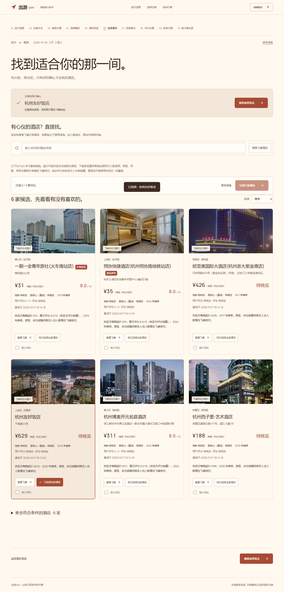
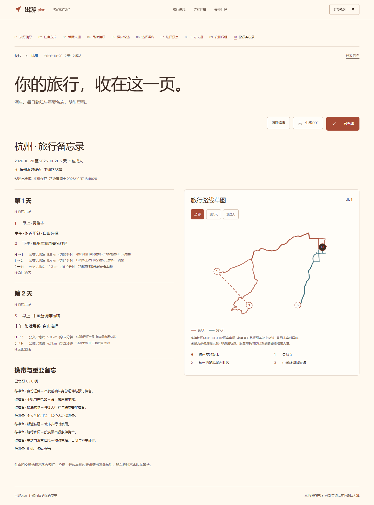

# 公开仓库体验与复现

团队：梧桐。主要提交人：[@fanxingfengming-pixel](https://github.com/fanxingfengming-pixel)。

## 环境与启动

项目使用 Node.js 内置 SQLite。原项目主服务实际验证环境为 Node.js 24.19.0；FlyAI Windows 子进程的已验证独立环境为 Node.js 24.20.0。此处记录验证环境，不代表其他版本全部兼容或不兼容。

所有项目命令在 D 盘项目目录执行。新克隆可使用 D:/CodexProjects/chuyou-plan；现有项目继续使用原目录，不需要复制。

1. 在项目目录安装锁定依赖：`npm.cmd ci --cache .npm-cache`。
2. 将 `.env.example` 复制为 `.env.server`，在本地填写自己的百炼 Workspace、Agent、Environment 和高德 Key。模板中的 Agent version 11 是原项目配置示例，应改为自己可用的 Agent 版本。
3. 为 FlyAI 配置自己的有效服务凭据。可使用已有 FlyAI 本地配置，或在 `.env.server` 中配置 `FLYAI_API_KEY`。Windows 如需独立运行环境，按模板设置 `FLYAI_NODE_PATH` 和 `FLYAI_NODE_VERSION`。
4. 新建 `.env.local`，填写以下公开配置：

```dotenv
VITE_TRAVEL_API_BASE=/api/travel
VITE_TRAVEL_DATA_MODE=live
```

5. 运行 `npm.cmd run build`，再运行 `npm.cmd run start`。
6. 在本机浏览器打开 http://127.0.0.1:5173/ 。`npm.cmd run status` 查看状态，`npm.cmd run stop` 停止本项目服务。

### 模拟体验

没有外部服务凭据时，将 `.env.local` 中的 `VITE_TRAVEL_DATA_MODE` 显式改为 `mock`，再构建并启动。模拟模式只展示模拟数据，不能作为真实百炼或供应方调用证据。

### 体验步骤

输入旅行需求 → 核对城市/日期/人数 → 选择住宿规划路径 → 比较城际交通 → 搜索并确认酒店 → 选择景点及市内交通 → 生成并编辑逐日路线 → 查看旅行备忘录并导出 PDF。

## 百炼接入复现边界

运行时使用 Managed Agent HTTP API（Session + SSE），服务端将任务说明和输入数据发送给 Agent，并校验结构化 JSON 结果。任务说明在 `server/agent-tasks.js` 和 `server/travel-api.js` 中。

云端 Agent/Environment 不属于 Git 仓库，复现者需要创建或配置自己的可用资源。原接入记录的模型为 `deepseek-v4-flash-0731`，当前控制台模型配置尚未在本次公开发布中重新核验。

源码与演示素材可公开复现；本地密钥、数据库、图片缓存、运行日志和内部历史资料不发布。地点数据库在首次使用时自动建立，真实查询逐步填充；仓库中的模拟目录独立使用。

## 展示材料与实际验证范围





图片来自 2026-10-17 V2.1 本地浏览器验收，展示真实应用界面。旅行前置草稿部分采用测试注入，后续酒店名称查询和高德路线等按原验收记录调用真实接口；不宣称这些截图代表从首页开始的全部真实链路。酒店价格仅对应截图查询时刻。

本次公开发布检查源码提交范围和敏感信息，类型检查、69项前端测试、46项服务端测试及构建均通过；实时供应方、百炼额度和公网部署需分别验证。公开仓库不等于已部署在线 Demo。本机回环地址不能提供给远程评审访问。

## 数据和素材

报价为供应方查询时起价，不保证特定房型、人数适用性或最终成交金额。用户确认酒店属于规划选择，不构成预订。

字体许可随 `public/fonts/OFL.txt` 保留。其他素材来源见 `ASSETS.json`、`public/images/*.json` 及素材记录；供应方来源不等于获得全量独立商用授权，复用前需核对适用许可。