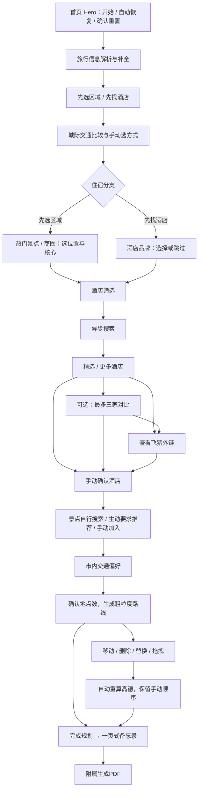

# 用户流程

基准：CP-V2-2026-10-17。功能规则引用 [FR](FUNCTIONAL_REQUIREMENTS.md)，状态变化引用[状态契约](STATE_AND_DATA_CONTRACT.md)。以下路线不是单页锚点。

## 主流程

图中外链是可选核对步骤，不是自动确认或必选预订步骤；用户可直接手动选择酒店。页面默认不推荐景点，不把区域候选自动加入正式景点。

## 独立 URL 与前置条件

| URL | 职责 | 前置条件 / 回退 |
| --- | --- | --- |
| / | Hero、开始、重置、当前草稿入口 | 可直接打开；自动恢复本地草稿，无恢复确认弹窗 |
| /plan/details | FR-002 信息解析和补全 | 无；保留原始需求 |
| /plan/mode | FR-003 住宿模式 | 必要旅行信息完整，否则补全 |
| /plan/transport | FR-004 城际交通 | 信息 + 住宿模式 |
| /plan/area | FR-005 区域分支 | 信息 + area 模式 + 城际交通方式 |
| /plan/hotel-preference | FR-006 酒店分支 | 信息 + hotel 模式 + 城际交通方式 |
| /plan/hotels | FR-007 酒店筛选 | 上述前置；area 分支还需手动核心地点 |
| /plan/results | FR-010 / FR-011 搜索状态和结果 | 同酒店筛选；无结果展示恢复，不伪造候选 |
| /plan/compare | FR-012 对比 | 同酒店筛选；没有勾选项显示返回选择入口 |
| /plan/places | FR-015 景点 | 已手动确认酒店，否则回酒店流程 |
| /plan/local-transport | FR-016 市内交通 | 已确认酒店、已加入景点；零景点情形见 K-008 |
| /plan/memo | FR-023 / FR-029 一页式旅行备忘录与PDF | 需核实完成的ready路线，否则回路线页并说明 |
| /plan/route | FR-017 / FR-018 真实路线与直接编辑 | 酒店、景点和市内偏好；生成前明确确认 |

现有代码在 App.tsx 实现守卫。表中的零景点门禁是当前实施状态，是否允许酒店-only 自由行未确认，不能当作新增永久限制。语义与独立路由是冻结要求，原任务允许等价命名；现有链接变更需兼顾草稿恢复。

## 酒店搜索分支

1. 提交保留筛选和旅行信息，创建可取消请求并进入 loading。
2. success：展示真实匹配结果，再由用户选择。empty：保留条件，展示 2–3 套放宽建议，由用户决定。
3. error：保留条件、明确失败和恢复入口；不换成模拟数据，不把原始密钥或技术堆栈暴露给用户。
4. timeout：可继续原请求、重新搜索或去放宽；继续等待不重复查询，重新搜索取消旧请求。
5. 条件 / 目的地变化或重置后，旧响应无权覆盖新草稿。
6. 刷新中断请求，恢复草稿到可重新搜索状态，不伪装后台仍在查询。

## 酒店外跳与返回

查看酒店 → 校验飞猪直链 → 外部页面核对房型 / 人数 / 最终价格 → 回到产品 → 用户手动“我已选择这家酒店” → 简洁确认 → 景点选择。

未登录轻提示不拦截。未点击手动确认时 selectedHotel 不变。无需程序判断用户是否下单，不能声称预订成功。

## 返回、修改和失效

- 返回上一步保留草稿，不无故重置表单。
- 改目的地：保留通用旅行信息，清空目的地关联项。
- 换酒店：保留筛选 / 核心 / 景点 / 市内偏好，清旧路线。
- 改景点、市内偏好或天数：旧路线失效；明确的路线编辑操作按用户意图同时更新景点与路线，避免被通用失效覆盖。
- D-10：拖拽后保留顺序并自动重算，计算中/失败禁用完成。备忘录PDF按当前快照导出，不触发优化。
- 日期、人数与住宿模式切换的剩余确认状态规则见 K-006，不能凭历史偶然行为做隐式决定。

## 恢复与重置

同浏览器、同来源再次打开 → 读取并验证 tripDraft → 自动恢复。坏数据 / 旧版本安全回退，保存失败有可见说明。不同浏览器或来源没有自动迁移承诺。

首页全部重置 → 二次确认：取消则原样保留；确认则取消请求并移除草稿，回初始状态。重置不清图片缓存或私密配置。

## D-08 · 故障与能力恢复

本地健康状态在页面显示；服务停止时保留输入与草稿，恢复后用户主动重试，不自动重发 Agent 查询。筛选先读取服务端能力；未支持控件显示暂不支持，旧值列出并等待「清除未支持条件」，然后才允许搜索。AI 不可用时真实酒店候选继续可查看并明确显示规则整理。日常启动 / 停止由根目录入口完成，保持 5173 来源。

## D-09 · 流程反馈补充

确认旅行信息后预读已收录城市的地点和图片；模式之后仍先比较城际交通。区域页加载时显示进度/骨架，完成为空才显示空状态。选择位置后手动设核心；核心进入景点步骤默认加入，移除后保留决定。路线页提供携带清单、备注和PDF。缺项继续操作定位问题，跳步返回说明原因；品牌仍可跳过。前进/后退轻微卷角，手机与减少动态设置按FR-026简化。

## D-10 · V2.1流程

新增 /plan/memo：需已核实ready路线，缺失回 /plan/route并说明。酒店指定搜索、替换对话框、逐日编辑、分店确认与失败恢复见 [V2.1规范](TRAVEL_V2_1_PRODUCT_SPEC.md)。

## D-11 · 品牌及最终路线恢复

先找酒店 → 八项品牌偏好卡片（七组可多选/不限清空）→ 酒店筛选。品牌偏好列表不等待供应方库存搜索。旧偏好移出范围时提示用户重选。路线页的失效酒店位置先重新定位，存在分店歧义时用户确认地址后继续；铁路失败不阻止已有酒店和景点的市内查询。部分路段不可用时可看真实点位连接草图和已成功路段，失败路段明确说明原因并允许主动重试。

## D-12 · 酒店筛选调整

酒店筛选页展示每晚价格、综合评分、最近装修年份；不再出现距地铁控件或其暂不支持提示。恢复旧草稿时自动移除该已删除条件，继续搜索无需清除它；其他暂不支持的旧条件仍由用户主动清除。结果页的放宽建议和PDF筛选偏好摘要也不再包含距地铁条件。
